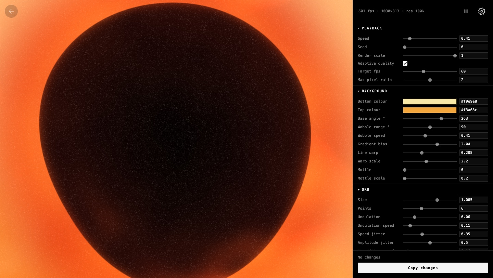

# Glimmers


Small moving things, made in the browser. Live at <https://jackbush.github.io/glimmers/>.

Every sketch shares one kit: a settings pane generated from the sketch's parameters, saved settings, a frame loop with adaptive quality, and a "Copy changes" button whose output Claude can bake back into the code.

## Run locally

```sh
npm install
npm run dev      # http://localhost:4321/glimmers/
npm run build    # writes dist/
npm run check    # type check + params check for every sketch
```

## Using a sketch

- **The play/pause button** (next to the cog) freezes the scene.
- **Space** hides or shows the buttons. The setting is shared by every sketch and remembered.
- **The cog** (top right) opens the settings pane. **Escape** closes it.
- **The arrow** (top left) goes back to the index.
- Edit any parameter, then **Copy changes** and paste the result to Claude to make it the new default. Double-click a label to reset one parameter, or use **[reset]** for all of them.

## Adding a sketch

Each sketch is a folder in `src/sketches/`. **The folder name is the URL.**

| File | What it is |
|---|---|
| `manifest.js` | The name and year, the page colour, and the cover capture settings |
| `params.js` | Every default value. The settings pane is generated from it |
| `sketch.js` | `create({ canvas, P })` → `{ resize, frame }` |
| `NOTES.md` | How the sketch works, its performance budget, and its benchmark history |
| `cover.mp4`, `cover.jpg` | The index cover, made by `scripts/capture.mjs` |

`src/sketches/index.js` controls which sketches the index lists, and in what order. An unlisted sketch still builds at its own URL.

Claude skills do the routine work: `new-glimmer` scaffolds a sketch, `glimmers-elements` adds or changes things, `glimmers-state` applies pasted settings, and `publish-glimmer` puts a sketch on the index after checking its cover and performance.

## Scripts

```sh
node scripts/check.mjs [slug…]     # params ↔ code consistency
node scripts/capture.mjs <slug>    # record the cover video (needs ffmpeg: brew install ffmpeg)
node scripts/bench.mjs [slug…] --fixed --size 2560x1440 --dpr 2   # real-GPU fps in headless Chrome
```

`capture` and `bench` build the site and start `astro preview` themselves.

## Deploy

Every push to `main` builds and deploys to GitHub Pages (`.github/workflows/deploy.yml`). Open tabs notice the new build and reload into it.


